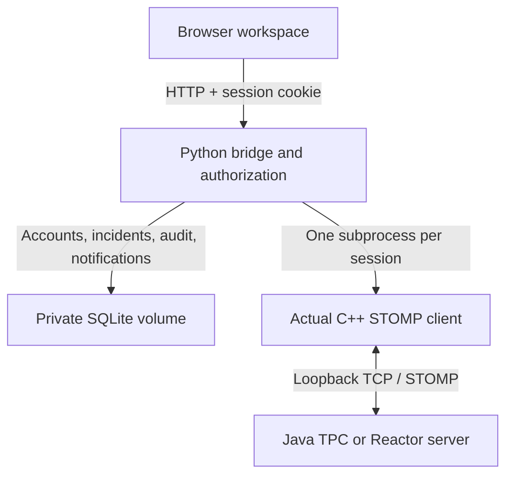

# Relay incident workspace

A small-team maintenance and incident workflow built around the original STOMP project.

The Java/C++ path still delivers live reports. The Python service is responsible for
browser authentication, channel access and the persistent incident workflow.
Legacy standalone Java mode retains its original educational authentication behavior;
only the authenticated launcher should be used for this web application.

## Product decisions

- Persistent incidents and transient messages are distinct: saving a report does not
  prove its delivery to every subscriber. Sending is not retried automatically.
- SQLite transactions, version checks and request IDs prevent conflicting updates
  and duplicated requests. SQLite and the current bridge are a single-host design.
- New fields migrate automatically: old incidents get normal priority and an empty
  location. Existing users and passwords are unchanged.
- Priority and exact location are persisted incident metadata. They do not change
  the original STOMP frame contract or the C++ summary format.
- Assignment notifications are in-app, polled every five seconds, persistent and
  visible only to the recipient while they retain channel access. The inbox shows
  the latest 20 accessible notifications; the badge counts unread items in that list.
- Overview counts include accessible incidents, not just the current table page.
  “Open over 24 hours” is a review aid, not an agreed response-time guarantee.
- The anonymous /demo page contains only fictional, static records and does not
  call authenticated endpoints or create live accounts.

## Demonstration in 90 seconds

1. Open /demo: filter incidents and open a side panel without registration.
2. In the live app, register two users and promote one administrator locally.
3. Create a report with priority and location, then assign it to a responder.
4. Sign in as that responder: see the inbox, claim work, and close the incident.
5. Restart the application: the incident, account and audit remain.
6. Explain the TPC/Reactor comparison using benchmarks/RESULTS.md and its limitations.

## Deployment boundary

Publish HTTPS only. Keep STOMP and monitoring private. Keep accounts.sqlite3,
bridge.key and backups outside source control and images. The supplied Compose
uses a private persistent volume. Do not delete that volume to redeploy.

Do not put secrets into browser JavaScript, Docker build arguments, screenshots or
CI output. Use the hosting secret store for future provider credentials and grant
minimal scope. Revoke and replace a leaked credential; removing a file is not enough.
The installer backup contains account data and must remain private.

Before public use: test Docker/TLS on the chosen host, verify account isolation,
restore a backup into a separate environment, and review rate limits and capacity.
No public deployment is claimed by this update. The source-hygiene CI gate detects
only selected file types and common key patterns; it is not a security audit.
